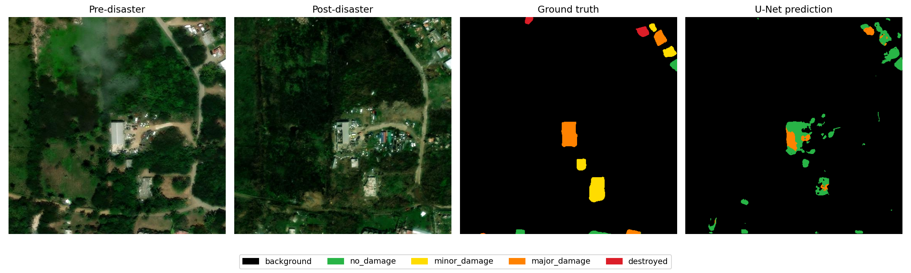

# Phần thực hiện của Lê Xuân Lộc — 23001533

## 1. Nhiệm vụ và phạm vi

Xây dựng mô hình U-Net sử dụng đồng thời ảnh vệ tinh trước và sau thiên tai bằng cách ghép ảnh theo chiều kênh. Mô hình dự đoán mask 5 lớp gồm nền, không hư hại, hư hại nhẹ, hư hại nặng và phá hủy. Chất lượng phân đoạn được đánh giá bằng IoU và Dice/F1 theo pixel. Mã nguồn bao gồm chuẩn bị dữ liệu, huấn luyện, đánh giá và suy luận phục vụ tích hợp demo.

## 2. Dữ liệu

Phần dữ liệu được cung cấp trong thư mục HURRICANE-IRMA gồm 788 cặp ảnh RGB kích thước 512×512 và các mask tương ứng. Kiểm tra 788 mask post-disaster cho thấy các mask có giá trị trong miền 0–4. Mask pre-disaster nhị phân không được dùng làm nhãn đích cho bài toán 5 lớp này.

| Nhãn | Lớp | Tổng số pixel | Tỷ lệ pixel (%) |
|---|---|---:|---:|
| 0 | Nền | 201.232.727 | 97,416 |
| 1 | Không hư hại | 2.550.971 | 1,235 |
| 2 | Hư hại nhẹ | 1.049.493 | 0,508 |
| 3 | Hư hại nặng | 1.237.507 | 0,599 |
| 4 | Phá hủy | 498.774 | 0,241 |

Đây là thống kê toàn bộ dữ liệu để mô tả bộ dữ liệu. Khi tính trọng số hàm mất mát, chương trình chỉ sử dụng các mẫu thuộc tập train. Phân bố cho thấy mất cân bằng lớn giữa nền và vùng công trình; chỉ số accuracy tổng thể không đủ phản ánh khả năng phân biệt mức thiệt hại.

Bộ chia được lưu cố định trong `splits.json` với seed 42, gồm 552 cặp train, 118 cặp validation và 118 cặp test, tương ứng tỷ lệ gần 70/15/15. Cả ba tập đều có đủ năm lớp. Các ảnh pre/post và mask của cùng một mẫu luôn thuộc cùng một tập. Nhóm sử dụng chung manifest này để so sánh mô hình. Dữ liệu chỉ thuộc một sự kiện; do chưa có tọa độ địa lý, cách chia ngẫu nhiên theo cặp ảnh chưa loại trừ được tương quan không gian giữa các tập.

## 3. Tiền xử lý

Ảnh được đọc ở dạng RGB, chuyển sang số thực và chuẩn hóa về [0,1] bằng cách chia cho 255. Ảnh trước và sau được ghép theo thứ tự pre RGB, post RGB, tạo tensor kích thước 6×512×512. Mask giữ dạng nhãn nguyên kích thước 512×512. Khi cần thay đổi kích thước, ảnh dùng nội suy bilinear và mask dùng nearest-neighbor để giữ giá trị nhãn.

Trong quá trình huấn luyện, dữ liệu được xoay ngẫu nhiên theo bội số 90 độ và lật ngang ngẫu nhiên. Cùng một phép biến đổi được áp dụng cho cả hai ảnh và mask để bảo toàn tương ứng không gian. Validation và test không sử dụng augmentation.

## 4. Mô hình U-Net 6 kênh

U-Net sử dụng nhánh thu hẹp để trích xuất ngữ cảnh và nhánh mở rộng để khôi phục thông tin vị trí. Kiến trúc nền tảng được tham khảo từ [Ronneberger, Fischer và Brox (2015), *U-Net: Convolutional Networks for Biomedical Image Segmentation*](https://arxiv.org/abs/1505.04597). Bản triển khai trong đề tài điều chỉnh đầu vào thành 6 kênh và đầu ra thành 5 lớp, sử dụng padding để giữ kích thước và bổ sung Batch Normalization.

Mô hình sử dụng cơ chế kết hợp sớm: hai ảnh được ghép trước khi đưa vào một encoder chung. Encoder gồm bốn khối, mỗi khối có hai lớp tích chập 3×3, Batch Normalization và ReLU; sau mỗi khối sử dụng Max Pooling 2×2. Trong thí nghiệm trên máy, số kênh lần lượt là 16, 32, 64 và 128; khối bottleneck có 256 kênh. Mô hình có 1.943.077 tham số có thể học.

Decoder dùng tích chập chuyển vị để tăng độ phân giải và ghép với đặc trưng tương ứng từ encoder qua skip connection. Sau các khối giải mã, tích chập 1×1 tạo 5 bản đồ điểm số. Lớp có điểm số lớn nhất tại mỗi pixel được chọn làm nhãn dự đoán. Cross entropy nhận trực tiếp logits, không áp dụng softmax trước hàm mất mát.

Ưu điểm của cách ghép 6 kênh là cấu trúc triển khai đơn giản và cho phép mạng khai thác đồng thời thông tin tại hai thời điểm ngay từ lớp đầu. Hạn chế là mô hình không có hai nhánh trích xuất đặc trưng riêng và không mô hình hóa tường minh phép so sánh đặc trưng giữa hai thời điểm.

## 5. Thiết lập thí nghiệm trên máy

Các thông số dưới đây tương ứng với cấu hình được lưu trong `runs/unet6_mps/config.json`. Cấu hình này dùng toàn bộ 552 mẫu train và 118 mẫu validation, không giới hạn mẫu để kiểm tra nhanh.

| Thành phần | Cấu hình |
|---|---|
| Input | 6×512×512 |
| Output | 5×512×512 logits |
| Optimizer | AdamW |
| Learning rate ban đầu | 0,001 |
| Weight decay | 0,0001 |
| Batch size | 4 |
| Số epoch tối đa | 20 |
| Loss | Cross entropy có trọng số lớp |
| Trọng số lớp | Nghịch đảo căn bậc hai số pixel train, chuẩn hóa trung bình 1 |
| Chọn checkpoint | mIoU validation của các lớp 1–4 lớn nhất |
| Giảm learning rate | ReduceLROnPlateau, factor 0,5, patience 3 |
| Dừng sớm | 5 epoch không cải thiện |
| Thiết bị huấn luyện | GPU Apple MPS |
| Seed | 42 |

Notebook Colab cung cấp thêm cấu hình base=32 và tối đa 40 epoch để chạy thí nghiệm mới. Kết quả của cấu hình đó cần được đo riêng, không dùng thay thế số liệu của lượt base=16 trên máy.

Nếu một lớp không có pixel trong train, mô hình không có ví dụ dương để học lớp đó. Cần kiểm tra thống kê từng split trước khi diễn giải kết quả. Mỗi cấu hình thí nghiệm được lưu vào một thư mục riêng để bảo toàn cấu hình, lịch sử huấn luyện và trọng số.

## 6. Phương pháp đánh giá

Với mỗi lớp c, xác định TP, FP và FN từ confusion matrix cộng dồn trên toàn bộ tập đánh giá:

`IoU(c) = TP(c) / [TP(c) + FP(c) + FN(c)]`

`Dice/F1(c) = 2TP(c) / [2TP(c) + FP(c) + FN(c)]`

Báo cáo từng lớp cùng trung bình 5 lớp và trung bình 4 lớp thiệt hại không gồm nền. Lớp không xuất hiện trong cả ground truth và dự đoán có chỉ số không xác định, được loại khỏi trung bình và ghi `null`. Nếu mô hình dự đoán nhầm vào một lớp không có trong ground truth thì lớp đó vẫn nhận điểm 0.

Các chỉ số trên đo độ chính xác phân đoạn theo pixel. Chúng không trực tiếp đánh giá số lượng công trình hoặc phân loại từng công trình. Đánh giá test được thực hiện ở độ phân giải mask gốc và chỉ dùng sau khi chốt cấu hình trên validation.

## 7. Kết quả thực nghiệm

Mô hình đã được huấn luyện đủ 20 epoch trên toàn bộ 552 cặp train, dùng 118 cặp validation để chọn checkpoint. Checkpoint tốt nhất thuộc epoch 20, được đánh giá một lần trên 118 cặp test ở độ phân giải gốc 512×512. Huấn luyện dùng GPU Apple MPS; đánh giá và chạy demo đã được kiểm chứng trên CPU. Tổng thời gian các epoch là 55.6 phút.

Bảng dưới là kết quả **test theo pixel**, lấy trực tiếp từ `runs/unet6_mps/test/metrics.json`, không phải kết quả của lượt kiểm tra nhanh.

| Lớp | IoU | Dice/F1 | Số pixel ground truth |
|---|---:|---:|---:|
| Nền | 98.21% | 99.10% | 30,095,472 |
| Không hư hại | 27.40% | 43.01% | 345,038 |
| Hư hại nhẹ | 0.07% | 0.14% | 198,037 |
| Hư hại nặng | 23.98% | 38.69% | 205,035 |
| Phá hủy | 1.29% | 2.54% | 89,410 |
| Macro 5 lớp | 30.19% | 36.70% | — |
| Macro 4 lớp thiệt hại | 13.19% | 21.10% | — |

### Phân tích kết quả

Trong bốn lớp thiệt hại, IoU cao nhất thuộc lớp Không hư hại (27.40%), thấp nhất thuộc lớp Hư hại nhẹ (0.07%).

Khi gộp các nhãn 1–4 thành vùng công trình, IoU đạt 54.06% và Dice đạt 70.18%. Đây là đánh giá vị trí công trình suy ra từ mask 5 lớp; nhầm giữa hai mức thiệt hại vẫn được tính là đúng vùng công trình trong phép đánh giá nhị phân này.

Tỷ lệ pixel công trình trong ground truth bị dự đoán thành nền là 23.96%. Để phân tích nhầm mức thiệt hại, đọc các ô ngoài đường chéo trong confusion matrix và đối chiếu ảnh minh họa.

Khả năng phân biệt mức độ thiệt hại còn hạn chế, đặc biệt lớp hư hại nhẹ và phá hủy. Dice nền cao không đại diện cho chất lượng nhận diện bốn mức thiệt hại. Kết quả vùng công trình khi gộp nhãn 1–4 cao hơn kết quả phân biệt từng mức, nên cần báo cáo hai nhiệm vụ rõ ràng.

Trong ảnh minh họa `HURRICANE-IRMA_014725`, một phần vùng hư hại nặng ở trung tâm được dự đoán đúng màu cam. Tuy nhiên, nhiều vùng ground truth màu vàng và đỏ bị bỏ sót hoặc đổi sang màu xanh/cam; biên dự đoán cũng còn lan ra xung quanh vùng công trình. Đây là ví dụ lỗi thực tế, không phải ảnh được chọn theo điểm dự đoán tốt nhất.

Chưa có kết quả Siamese U-Net và DeepLabV3+ trong phần thực hiện này. Khi ghép báo cáo nhóm, so sánh các mô hình trên cùng manifest, độ phân giải và định nghĩa metric; không suy luận mô hình nào tốt hơn từ các cấu hình chưa được chạy.

## 8. Tích hợp và bàn giao

Hàm `infer_pair` nhận mô hình cùng hai đường dẫn ảnh, trả về mask uint8 ở kích thước ảnh gốc với nhãn 0–4. Chương trình suy luận có thể xuất mask nhãn, mask màu, vùng công trình, ảnh chồng màu và số pixel từng lớp. Việc thống kê số công trình theo mức thiệt hại cần bổ sung cơ chế xác định từng công trình; không đồng nhất số vùng liên thông với số công trình thực tế khi các công trình sát nhau.

Các sản phẩm bàn giao gồm mã nguồn `unet6/`, notebook Colab, `splits.json`, checkpoint tốt nhất, cấu hình huấn luyện, bảng chỉ số và ảnh trực quan. README hướng dẫn cách chạy và tích hợp.
